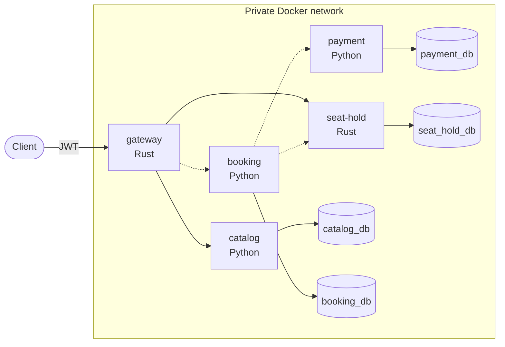

# Ticketing

[](https://github.com/bzadorozhnyi/ticketing/actions/workflows/ci.yml)

A learning and portfolio project for distributed-systems patterns, built around one domain:
selling tickets to events with limited seats and a traffic spike at the start of sales.

The microservices are deliberate, and features are secondary. The point is to break things on purpose
and keep the evidence: every reliability claim in this repository links to a test or a recorded measurement.

## Architecture



Solid lines work today; dotted lines are planned.

| Service | Language | Role | State |
|---|---|---|---|
| gateway | Rust, Axum | The only entry point: routing, JWT auth, trace start, limits | Routes catalog, seat-hold and booking |
| catalog | Python, FastAPI | Events, venues, seat maps, prices | Read API |
| booking | Python, FastAPI | Orders, idempotency keys, saga orchestrator | Runs the purchase saga and recovers stuck ones |
| payment | Python, FastAPI | Mock provider with fault injection | Idempotent charges and refunds from RabbitMQ |
| seat-hold | Rust, Axum | Authoritative seat holds with a TTL | Holds and releases seats |

Each service owns its database. The gateway checks who the caller is and passes the user in `X-User-Id`;
a service decides what that user may do. Services trust this header, so they are reachable only through the gateway.

## Run it

Needs Docker. No configuration is required: compose holds development values.

```
docker compose up -d --wait --build
docker compose run --rm catalog python -m scripts.seed
```

The gateway is on `localhost:8000`. Every `/api` route needs a token:

```
curl localhost:8000/api/v1/events                 # 401

TOKEN=$(docker compose exec -T gateway issue-token user-1)
curl -H "Authorization: Bearer $TOKEN" localhost:8000/api/v1/events
```

A purchase holds seats, places an order and polls it. `tok_ok` pays, `tok_declined` is refused:

```
AUTH="Authorization: Bearer $TOKEN"
curl -H "$AUTH" -H "Content-Type: application/json" localhost:8000/api/v1/holds \
  -d '{"event_id": "<event id>", "seat_ids": ["<seat id>"]}'                       # 201, hold_id
curl -H "$AUTH" -H "Content-Type: application/json" -H "Idempotency-Key: $(uuidgen)" \
  localhost:8000/api/v1/orders -d '{"hold_id": "<hold id>", "payment_token": "tok_ok"}'  # 202, id
curl -H "$AUTH" localhost:8000/api/v1/orders/<order id>                                # pending, then confirmed
```

## Evidence

- [docs/CLAIMS.md](docs/CLAIMS.md): each reliability claim, its evidence and its known limits.
- [docs/LEARNINGS.md](docs/LEARNINGS.md): what was learned and what was a surprise.
- [docs/adr/](docs/adr/): decisions and their consequences.

Rust is allowed only where a benchmark against a Python baseline justifies it.
[ADR 0002](docs/adr/0002-rust-for-the-gateway.md) records the result for the gateway: 3.7x the requests per CPU and 4.5x lower p99 than the same proxy in Python,
but almost no difference for a client while catalog is the slower part. [ADR 0004](docs/adr/0004-rust-for-seat-hold.md) records seat-hold:
about 2x the requests per CPU and a 2.5x shorter tail, a gap that closes as CPUs are added. The benchmarks live in [infra/benchmark/](infra/benchmark/).

## Development

Each service is self-contained, with its own dependencies, tests and a `CLAUDE.md` that lists its commands.

```
pre-commit install                     # ruff, ty, cargo fmt, clippy, contract check

cd services/catalog                    # the same for booking and payment
cp .env.test.example .env.test
uv run pytest                          # needs the compose stack: tests use a real Postgres

cd services/gateway
cargo test
```

Python 3.14 with uv, Rust 1.99, Postgres 18.

Repository layout:

```
services/<name>/    one directory per service
contracts/          generated OpenAPI per service
infra/              repository scripts and benchmarks
docs/               board, ADRs, claims, learnings
```

## Roadmap

| Milestone | Topic | State |
|---|---|---|
| M1 | Service skeletons, gateway, contracts | Done |
| M2 | Concurrency and seat holds | Done |
| M3 | Saga and idempotency | Done |
| M4 | Resilience: timeouts, retries, circuit breaker | Done |
| M5 | Load spike: rate limiting, load shedding, p95 and p99 | Done |
| M6 | Observability | Done |
| M7 | Replica lag, expand/migrate/contract migrations | In progress |
| M8 | Kubernetes on minikube | Planned |
