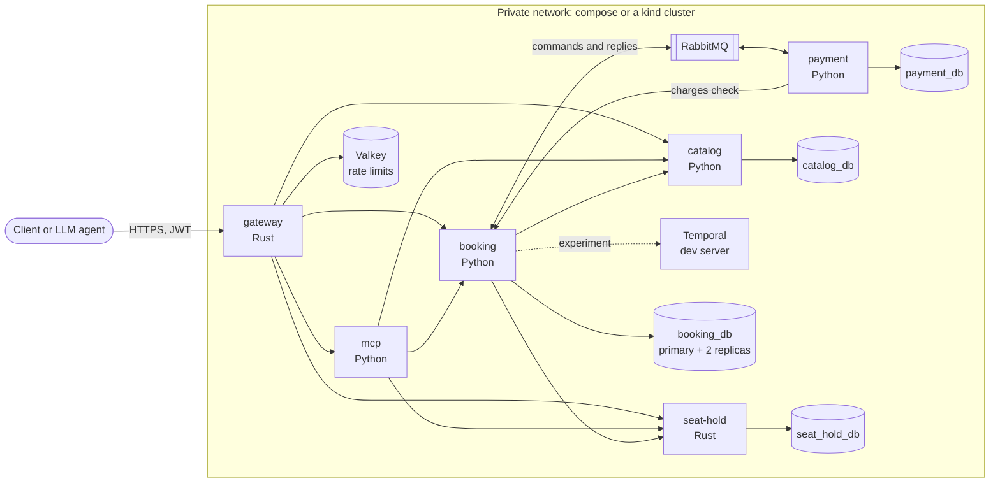

# 🎟️ Ticketing

[](https://github.com/bzadorozhnyi/ticketing/actions/workflows/ci.yml)


A learning and portfolio project for distributed-systems patterns, built around one domain:
selling tickets to events with limited seats and a traffic spike at the start of sales.

The microservices are deliberate, and features are secondary. The point is to break things on purpose
and keep the evidence: every reliability claim in this repository links to a test or a recorded measurement
in [docs/CLAIMS.md](docs/CLAIMS.md), and a design that did not pay off was measured and removed, not kept.

## 🏗️ Architecture



In the kind cluster an Envoy edge terminates TLS and HTTP/2 in front of the gateway. The dotted line is an experiment.

| Service | Language | Role |
|---|---|---|
| 🚪 gateway | Rust, Axum | The only entry point: JWT auth, routing, per-user rate limits (Valkey), retries with a budget, circuit breakers, bulkheads, load shedding, trace start |
| 📚 catalog | Python, FastAPI | Events, venues, seat maps, prices; seat maps cached in each process with single flight |
| 💺 seat-hold | Rust, Axum | Authoritative seat holds with a TTL: no seat held by two users, a per-user limit, idempotency keys |
| 🧾 booking | Python, FastAPI | Orders with idempotency keys, the purchase saga (outbox, recovery), reads from replicas |
| 💳 payment | Python, FastAPI | Mock payment provider with fault injection; idempotent charges and refunds from RabbitMQ; pages a person when a charge has no order |
| 🤖 mcp | Python, MCP SDK | The public API as MCP tools for an LLM agent, behind the gateway at `/mcp` |

Each service owns its database. The gateway checks who the caller is and passes the user in `X-User-Id`;
a service decides what that user may do. Services trust this header, so they are reachable only through the gateway.

## 🧰 What is in it

Each line links to the decision or the evidence. Numbers are from one laptop.

**🔒 Correctness under concurrency**
- One winner per seat under 100 concurrent clients, and a Jepsen-style check of recorded histories under crashes and
  pauses of seat-hold and its database: no seat ever held by two users ([ADR 0003](docs/adr/0003-seat-hold-storage.md), TIK-23, TIK-87).
- Idempotency keys on holds, orders and the provider call; 50 concurrent duplicates give one order and one charge.

**💸 The purchase saga and money**
- An orchestrated saga with persisted state, a transactional outbox to RabbitMQ and recovery of stuck orders
  ([ADR 0005](docs/adr/0005-inter-service-communication.md)). Processes killed after every step: money taken exactly once or returned (TIK-35).
- A dead-letter queue for poison replies, and a check every minute that each kept charge has its order
  ([ADR 0013](docs/adr/0013-coherence-check-of-charges.md)).

**🛡️ Resilience and load**
- Gateway retries only what is safe to repeat, within a retry budget; circuit breakers and bulkheads per upstream;
  rate limits shared in Valkey; load shedding; limits that fit its memory.
- A sales spike of 5,000 users at once sells every seat exactly once, and the first to arrive get the seats, so no
  waiting room was built (TIK-44, TIK-85).
- Rust only where a benchmark against Python justifies it: the gateway 3.7x the requests per CPU
  ([ADR 0002](docs/adr/0002-rust-for-the-gateway.md)), seat-hold about 2x ([ADR 0004](docs/adr/0004-rust-for-seat-hold.md)).

**🐘 Data and Postgres**
- A read replica with read-your-writes through a consistency token ([ADR 0007](docs/adr/0007-booking-read-replica.md)),
  and schema changes without downtime: expand, migrate, contract, with lock timeouts and retries ([ADR 0008](docs/adr/0008-schema-changes-without-downtime.md)).
- booking's Postgres run by CloudNativePG: failovers measured for lost orders and recovery time, asynchronous against
  synchronous replication, a hung primary that came back as a second one, and the fix ([ADR 0012](docs/adr/0012-booking-postgres-failover.md)).
- The commit path (WAL, fsync, group commit), a forgotten `BEGIN` that cut holds to a quarter and the fix, and the
  finding that the remaining ceiling is the laptop, not the design (TIK-112 to TIK-114).

**🔭 Observability**
- OpenTelemetry traces and metrics, one trace per order through RabbitMQ, tail sampling, Prometheus, Tempo and Grafana,
  SLOs with burn-rate alerts; a failure found from dashboards and traces alone ([ADR 0006](docs/adr/0006-observability.md), [ADR 0010](docs/adr/0010-tail-sampling.md)).

**☸️ Kubernetes**
- The whole system on kind in one script: rolling updates with no failed request, pods killed under load with none
  failing, an autoscaler under a spike, an Envoy Gateway edge with TLS and HTTP/2 ([ADR 0009](docs/adr/0009-kubernetes-on-kind.md), [ADR 0011](docs/adr/0011-envoy-gateway-at-the-edge.md)).

**🤖 LLM in the backend**
- An MCP server: an agent finds events, holds seats and orders, while the user, not the model, confirms a payment
  ([ADR 0017](docs/adr/0017-mcp-server.md)). Evals grade the system's state, not the agent's words: 27 of 27 (TIK-111).

**↩️ Decisions measured and reversed**
- A CQRS copy of seat availability in catalog, fed by seat-hold's events: it cut refusals by 31 % where 50 % was
  agreed beforehand, so it was removed in two releases ([ADR 0015](docs/adr/0015-catalog-seat-availability.md)).

## 🧪 Temporal (experiment)

⚠️ **Status: an experiment (M9), not part of the production path.** booking's own saga stays the default and is not removed.

The goal is to build the same purchase saga a second way, with [Temporal](https://temporal.io) durable execution,
and compare the two with evidence: the crash experiment of TIK-35 on both, the Temporal server stopped under load,
and the time from order to `confirmed`. The engine will be chosen per order by a setting, so either can run.
See [ADR 0018](docs/adr/0018-temporal-saga-engine.md).

| Step | State |
|---|---|
| TIK-115: Temporal's development server in compose and kind, this ADR | ✅ Done |
| TIK-116: the workflow, its activities and a worker in booking, beside the saga; every branch tested | ✅ Done |
| TIK-117: both engines under crashes and an outage of the Temporal server; latency | ✅ Done |
| TIK-118: timeouts that find a dead worker in seconds (per activity, heartbeats, workflow task): 144 s down to 57 to 68 s | ✅ Done |

**Result (TIK-117).** Under the same faults both engines kept every order's money right: 135 confirmed with one
charge each and 15 declined with none, in every run. Temporal recovered more slowly after a worker crash (144 s
against 34 s for 150 orders under 5 % crash points: an activity of a dead worker waits for its 30 s timeout; 57 to 68 s
with shorter timeouts and heartbeats, TIK-118), was as
fast when random processes were killed, and survived its own server stopped for 60 s or killed. Its p50 time to
`confirmed` was 1.3 s against 0.7 to 1.05 s for the saga, on Temporal's development server. Details in
[ADR 0018](docs/adr/0018-temporal-saga-engine.md#measured-tik-117).

```
SAGA_ENGINE=temporal docker compose --profile temporal up -d --wait --build   # new orders go through Temporal
```

The Temporal server and booking's worker start only with the `temporal` profile; Temporal's UI is on
http://localhost:8233. Without `SAGA_ENGINE=temporal` new orders keep using booking's own saga. The workflow is
[order_workflow.py](services/booking/src/orders/workflows/order_workflow.py).

## 🚀 Run it

Needs Docker. No configuration is required: compose holds development values.

```
docker compose up -d --wait --build
docker compose run --rm catalog python -m scripts.seed
```

The gateway is on `localhost:8000`. Every `/api` route needs a token:

```
curl localhost:8000/api/v1/events                 # 401

TOKEN=$(docker compose exec -T gateway issue-token user-1)
curl -H "Authorization: Bearer $TOKEN" localhost:8000/api/v1/events
```

A purchase holds seats, places an order and polls it. `tok_ok` pays, `tok_declined` is refused:

```
AUTH="Authorization: Bearer $TOKEN"
curl -H "$AUTH" -H "Content-Type: application/json" localhost:8000/api/v1/holds \
  -d '{"event_id": "<event id>", "seat_ids": ["<seat id>"]}'                       # 201, hold_id
curl -H "$AUTH" -H "Content-Type: application/json" -H "Idempotency-Key: $(uuidgen)" \
  localhost:8000/api/v1/orders -d '{"hold_id": "<hold id>", "payment_token": "tok_ok"}'  # 202, id
curl -H "$AUTH" localhost:8000/api/v1/orders/<order id>                                # pending, then confirmed
```

With `TICKETING_TOKEN` set to such a token, Claude Code opened in this repository reaches the MCP server through
`.mcp.json` ([services/mcp/CLAUDE.md](services/mcp/CLAUDE.md)). The same system on Kubernetes: [infra/k8s/README.md](infra/k8s/README.md).

## 📊 Evidence

- 📋 [docs/CLAIMS.md](docs/CLAIMS.md): each reliability claim, its evidence and its known limits.
- 💡 [docs/LEARNINGS.md](docs/LEARNINGS.md): what was learned and what was a surprise.
- 🧭 [docs/adr/](docs/adr/): decisions and their consequences.
- 🗂️ [docs/BOARD.md](docs/BOARD.md): every ticket, done and planned.

## 🛠️ Development

Each service is self-contained, with its own dependencies, tests and a `CLAUDE.md` that lists its commands.

```
pre-commit install                     # ruff, ty, cargo fmt, clippy, contract check

cd services/catalog                    # the same for booking, payment and mcp
cp .env.test.example .env.test
uv run pytest                          # needs the compose stack: tests use a real Postgres

cd services/gateway                    # the same for seat-hold
cargo test
```

Python 3.14 with uv, Rust 1.99, Postgres 18. CI runs every service's checks, `uv audit` and `cargo-deny`, a breaking
change check of the API contracts, the observability configs and a dry run of the Kubernetes manifests.

Repository layout:

```
services/<name>/    one directory per service
contracts/          generated OpenAPI per service
infra/              compose helpers, Kubernetes (kind), observability, benchmarks, CI scripts
docs/               board, ADRs, claims, learnings
```

## 🗺️ Roadmap

| Milestone | Topic | State |
|---|---|---|
| M1 | Service skeletons, gateway, contracts | ✅ Done |
| M2 | Concurrency and seat holds | ✅ Done |
| M3 | Saga and idempotency | ✅ Done |
| M4 | Resilience: timeouts, retries, circuit breaker | ✅ Done |
| M5 | Load spike: rate limiting, load shedding, p95 and p99 | ✅ Done |
| M6 | Observability | ✅ Done |
| M7 | Replica lag, expand/migrate/contract migrations | ✅ Done |
| M8 | Kubernetes on kind | ✅ Done |
| After M8 | Review fixes, Postgres failover, Jepsen-style checks, CQRS measured and reverted, caching, MCP and evals, Postgres internals | ✅ Done |
| M9 | Temporal as a second saga engine | 🧪 Experiment, measured |
